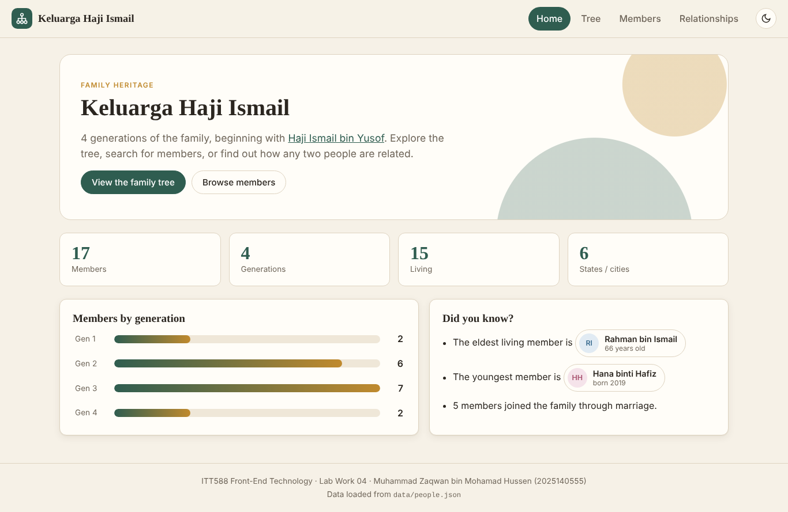
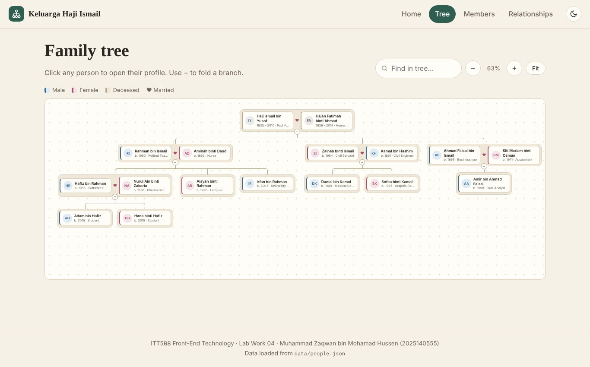
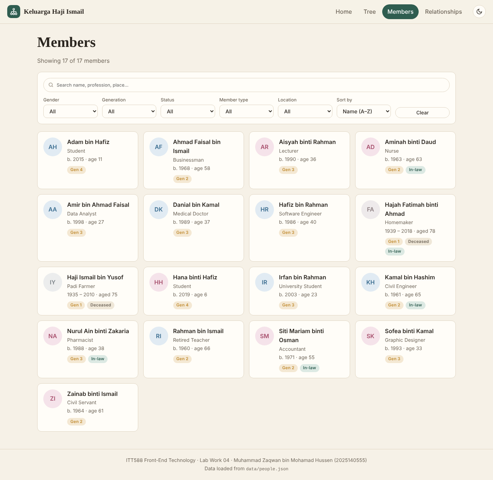
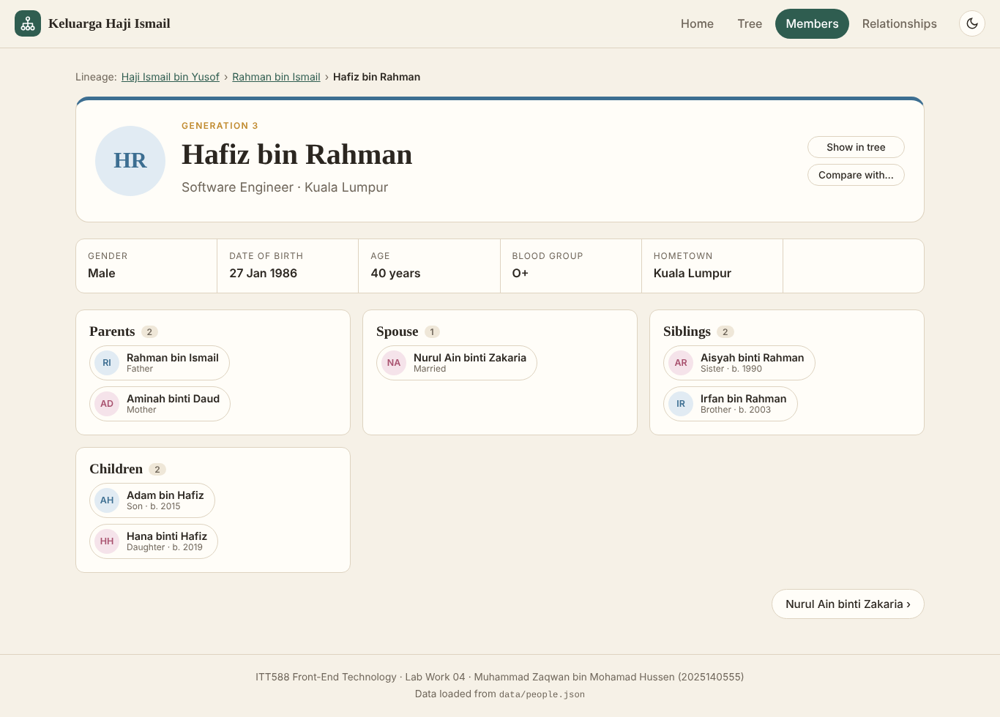
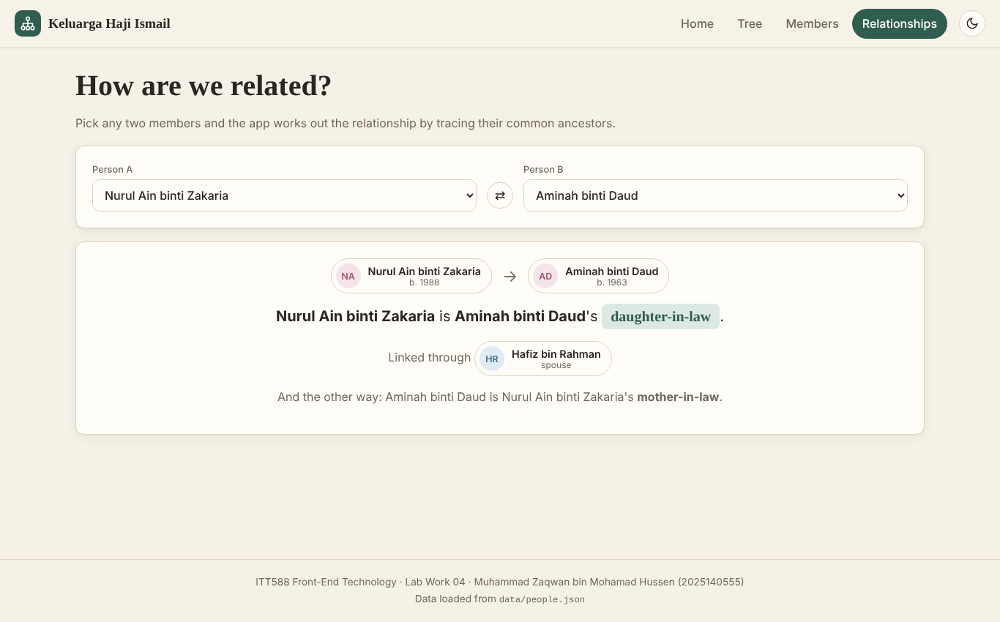
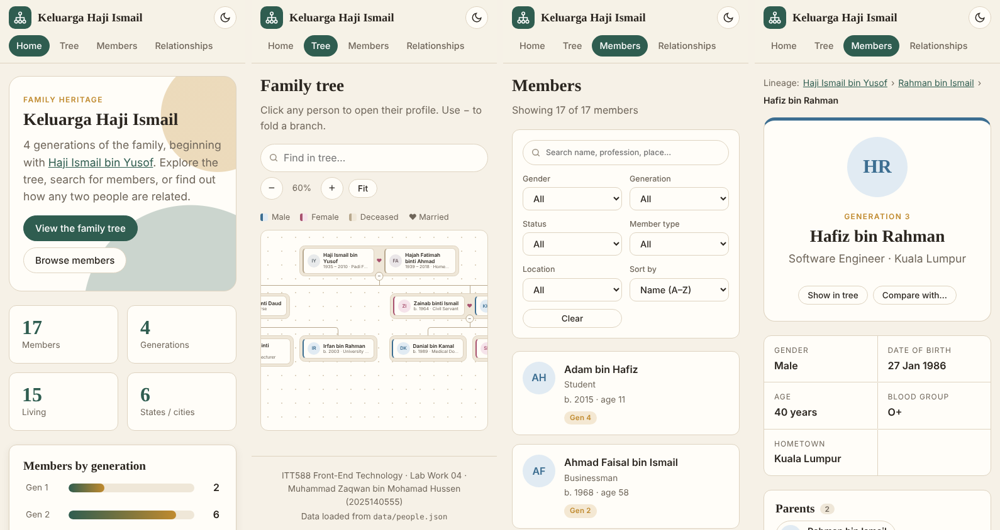
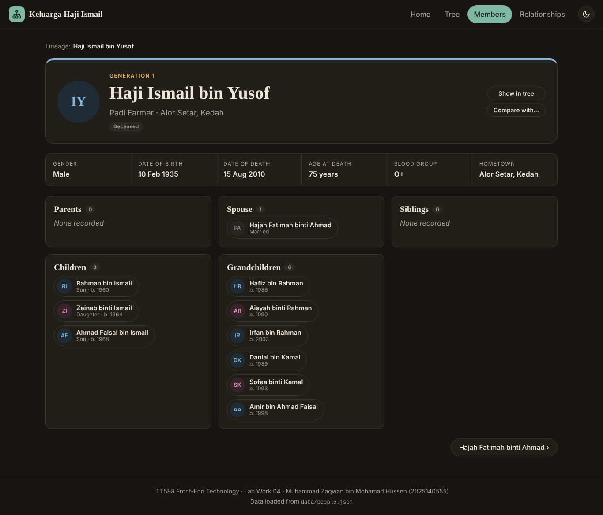

# Lab Work 04 — Interactive Family Tree Web Application

**ITT588 Front-End Technology** · Muhammad Zaqwan bin Mohamad Hussen · 2025140555 · CDCS2666B

A responsive front-end web application that **retrieves family heritage data from a JSON dataset** and **visualises it dynamically with JavaScript**. You can see the family as an interactive tree, browse and filter every member, open a profile for each person showing their parents, spouse, siblings and children, and work out how any two people are related.

📑 **Presentation slides:** [ITT588_LAB_4_MUHAMMAD_ZAQWAN_2025140555.pdf](ITT588_LAB_4_MUHAMMAD_ZAQWAN_2025140555.pdf)



---

## How the lab objectives are met

| Lab objective | Where it is done |
|---|---|
| Retrieve and process family heritage data from a JSON dataset using JavaScript | `js/data.js` loads `data/people.json` with `fetch()`, checks every record and reference, and builds lookup tables for parents, children and generations |
| Display family member information and relationships dynamically | Every page is generated from the JSON data at runtime by `js/views.js`. Nothing about the family is hard-coded in the HTML |
| Visualise parents, spouses and children using HTML, CSS and JavaScript | **Tree** page (couples joined by ♥, children drawn below with connector lines), plus a **Profile** page for each person |
| Implement data filtering and navigation | **Members** page with search and 6 filters plus sorting. Hash-based navigation with working Back/Forward buttons, a lineage breadcrumb, previous/next buttons and "Show in tree" |

---

## Features

### 1. Family tree


- Built recursively from the JSON: each "family unit" is a blood relative with their spouse, and their children branch underneath.
- Colour coding for male, female and deceased members, with a ♥ for married couples.
- **Find in tree** dims everyone except the people who match and scrolls to the first match.
- **Zoom in/out and Fit**, and **fold/unfold** any branch with the − / + button.
- Clicking any card opens that person's profile.

### 2. Members directory: search, filter and sort


- Search across name, profession and place.
- Filters: **gender, generation, living/deceased, blood relative/in-law, location**.
- Sort by name, oldest, youngest or generation. A live count shows "Showing X of Y members".
- Filters are kept when you open a profile and come back.

### 3. Member profile


- Details: date of birth, age (or age at death), blood group and hometown.
- **Lineage breadcrumb** tracing the person back to the eldest ancestor.
- Relationship sections for **Parents, Spouse, Siblings, Children and Grandchildren**. Each one links to that person.
- Previous/next buttons step through the same generation.

### 4. "How are we related?" (extra feature)


Pick any two members and the app works out their relationship. It finds their **closest common ancestor** with a breadth-first search, then turns the number of generations between them into a word: *great-grandson, aunt, first cousin once removed*. It also handles marriage: *daughter-in-law, brother-in-law, uncle (by marriage)*.

### 5. Responsive, dark mode and accessibility



- Works on phone, tablet and desktop (CSS Grid/Flexbox with media queries).
- Light/dark theme toggle, remembered with `localStorage`.
- Keyboard friendly (skip link, visible focus, ARIA labels), and respects *reduced motion*.

### 6. Error handling
- If the JSON file is missing, unreachable or malformed, a clear message with a **Try again** button is shown instead of a blank page.
- Data problems such as a missing field, a duplicate `id` or a `fatherId` pointing to nobody are listed in a warning banner, and the app keeps running.
- Opening `index.html` straight from the folder (`file://`) shows instructions for running it through a local server.
- Every value from the JSON is HTML-escaped before display, so the data cannot inject code into the page.

---

## The JSON dataset

`family-tree/data/people.json` follows the structure of the sample dataset given in the lab ([geoseiden/Family-Tree](https://github.com/geoseiden/Family-Tree/blob/main/public/data/people.json)):

```json
{
  "title": "Keluarga Haji Ismail",
  "people": [
    {
      "id": "p3",
      "name": "Rahman bin Ismail",
      "gender": "male",
      "photo": "",
      "phone": "",
      "address": "Sungai Petani, Kedah",
      "dob": "1960-03-09",
      "dateOfDeath": "",
      "profession": "Retired Teacher",
      "bloodGroup": "O+",
      "fatherId": "p1",
      "motherId": "p2",
      "spouses": [{ "id": "p4", "status": "married" }],
      "isInLaw": false
    }
  ]
}
```

- `fatherId` / `motherId` link a child to their parents. Children, siblings and grandchildren are **worked out** from these links rather than stored.
- `spouses` lists marriages with a status (`married`, `divorced`, …).
- `isInLaw` marks people who joined the family through marriage.
- `photo` can hold an image path. If it is empty, the app shows the person's initials.

The dataset has **17 members across 4 generations**.

---

## Project structure

```
Lab 4/
├── README.md              ← this write-up
├── ITT588_LAB_4_….pdf     ← presentation slides
├── screenshots/
└── family-tree/
    ├── index.html         ← page shell: header, navigation, <main> container
    ├── css/style.css      ← theme variables, layout, tree connectors, responsive rules
    ├── data/people.json   ← the family heritage dataset
    └── js/
        ├── app.js         ← entry point: loads data, hash router, theme toggle
        ├── data.js        ← data layer: fetch, validation, relationship logic
        └── views.js       ← presentation layer: renders each page and its events
```

The code is split by responsibility, much like a simple MVC structure: **data.js** is the model, **views.js** holds the views, and **app.js** is the controller/router. Plain HTML, CSS and JavaScript (ES modules) are used, with no framework or build step.

---

## How to run

Browsers block JavaScript modules and `fetch()` on pages opened as `file://`, so serve the folder through a local web server:

- **VS Code:** right-click `family-tree/index.html` and choose **Open with Live Server**, or
- **Python:** from the `family-tree` folder run `python -m http.server` and open <http://localhost:8000>.

Pages (hash routes): `#/` home · `#/tree` · `#/members` · `#/person/<id>` · `#/relate?a=<id>&b=<id>`
